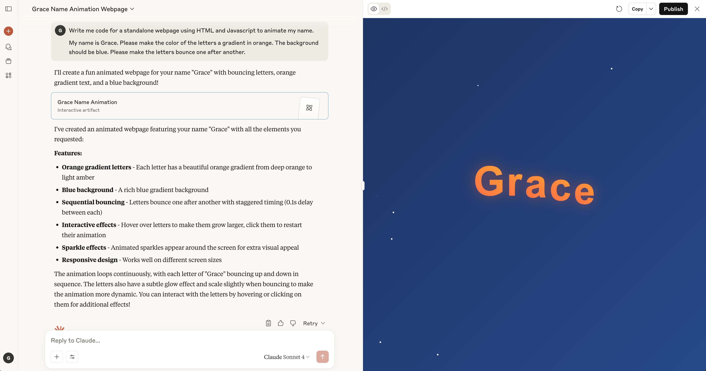
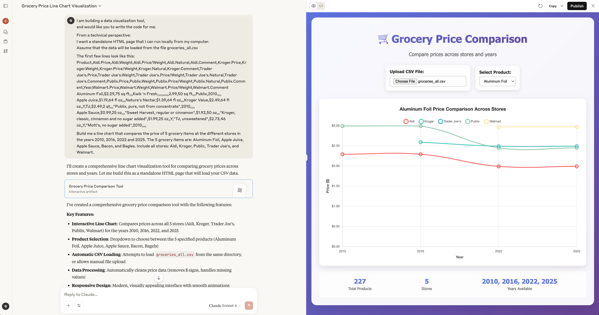
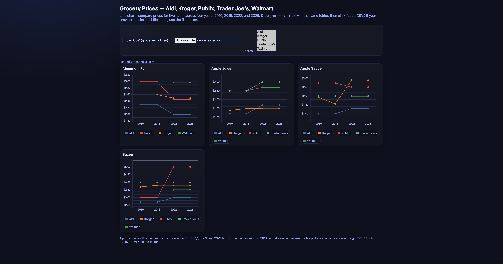
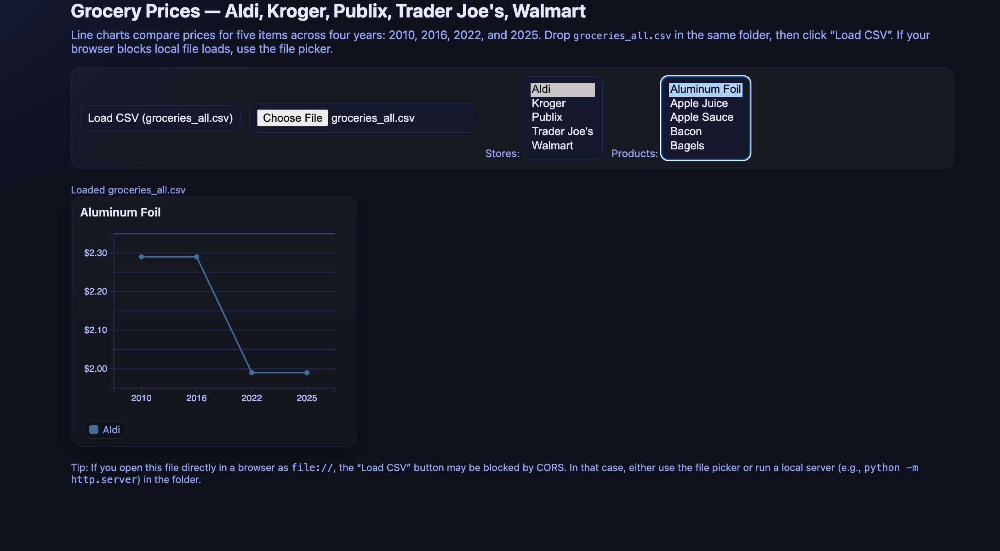
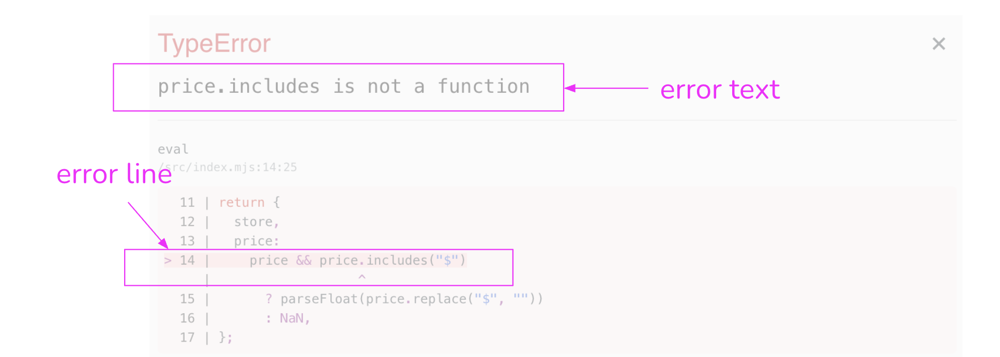
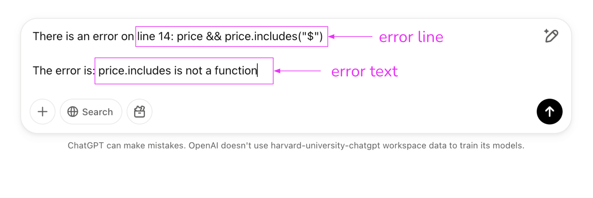

<!-----
layout: lab
exclude: true
----->


&nbsp;

# Week 3 - Lab

## Learning Objectives

- Master the basic prompt when asking an LLM, such as Claude or ChatGPT, for a visualization
- Describe one or more datasets to the LLM
- Describe the intended visualization to the LLM
- Iterate on the visualization
- Identify and handle common bugs in the code
- Download and run the generated visualization code locally

### Prerequisites

- You have downloaded the [groceries dataset](template/activity_123/groceries_all.csv) for this week's lab.
- You have set up an account for some LLM (Claude, ChatGPT, Gemini etc.)

---

## Activity 0: Hello, My Name is...

Before we jump into vibecoding visualizations, let's do a quick self-introduction.

Using your LLM of choice, enter a prompt describing an animation of your name. For example:

```
Write me code for a standalone webpage using HTML and Javascript to animate my name.

My name is Grace. Please make the color of the letters a gradient in orange. The background should be blue. Please make the letters bounce one after another.
```

If you are using Claude, the in-browser artefacts should automatically display the result of the code.
(Notice how Claude added some nice sparkles.)


If you are using ChatGPT, you will have to copy the code and save it on your laptop as a `index.html` file.
You can then open the file in any browser to see your animation. (No sparkles ):


---

## Activity 1: Writing a Visualization Prompt

The file [groceries_all.csv](template/activity_123/groceries_all.csv) contains historic grocery prices from years 2010, 2016, 2022, and 2025.

Each row includes the name of the Product, the Year the price was recorded, and the Price and Weight of the product at four stores: Aldi, Kroger, Publix, Trader Joe's, and Walmart.

There are some additional columns, such as Price/Weight and Comment, that have been included for completeness.

This data was compiled by [CompareGroceryPrices.ORG](https://www.comparegroceryprices.org/index.html).

### Data contents and format

The fields relevant to this example are:
* Product: Name of the product, products may have similar names (e.g. "Eggs, cage free" and "Eggs, regular")
* Year: The year in which price and weight data was recorded for a product
* Aldi.Price: Price of product at Aldi
* Aldi.Weight: How much product is provided for the price at Aldi
* Kroger.Price: Price of product at Kroger
* Kroger.Weight: How much product is provided for the price at Kroger
* Publix.Price: Price of product at Publix
* Publix.Weight: How much product is provided for the price at Publix
* Trader Joe's.Price: Price of product at Trader Joe's
* Trader Joe's.Weight: How much product is provided for the price at Trader Joe's
* Walmart.Price: Price of product at Walmart
* Walmart.Weight: How much product is provided for the price at Walmart

### Writing a Prompt

The template of a prompt requires 4 main components:
- Overall task description
- Technical implementation details (HTML, Javascript etc.)
- Copy of the first few rows of your dataset(s)
- Detailed description of the visualization

For example:

```
I am building a data visualization tool,
and would like you to write the code for me. 

From a technical perspective:
I want a standalone HTML page that I can run locally from my computer.
Assume that the data will be loaded from the file groceries_all.csv

The first few lines look like this:
Product,Aldi.Price,Aldi.Weight,Aldi.Price/Weight,Aldi.Natural,Aldi.Comment,Kroger.Price,Kroger.Weight,Kroger.Price/Weight,Kroger.Natural,Kroger.Comment,Trader Joe's.Price,Trader Joe's.Weight,Trader Joe's.Price/Weight,Trader Joe's.Natural,Trader Joe's.Comment,Publix.Price,Publix.Weight,Publix.Price/Weight,Publix.Natural,Publix.Comment,Year,Walmart.Price,Walmart.Weight,Walmart.Price/Weight,Walmart.Comment
Aluminum Foil,$2.29,75 sq ft,,,Kwik 'n Fresh,,,,,,,,,,,2.99,50 sq ft,,,Publix,2010,,,,
Apple Juice,$1.19,64 fl oz,,,Nature's Nectar,$1.39,64 fl oz,,,Kroger Value,$2.49,64 fl oz,,Y,TJ,$2.49,2 qt,,,"Publix, pure, not from concentrate",2010,,,,
Apple Sauce,$0.99,25 oz,,,"Sweet Harvest, regular or cinnamon",$1.92,50 oz,,,"Kroger, classic, cinnamon and no sugar added",$1.99,25 oz,,Y,"TJ, unsweetened",$2.73,46 oz,,Y,"Mott's, no sugar added",2010,,,,

Build me a line chart that compares the price of 5 grocery items at the different stores in the years 2010, 2016, 2022 and 2025. The 5 grocery items are: Aluminum Foil, Apple Juice, Apple Sauce, Bacon, and Bagles. Include all stores: Aldi, Kroger, Public, Trader Joe's, and Walmart.
```

### Viewing the visualization

Once again, if you used Claude for the above prompt, the browser artefact should automatically display the resulting visualization:


However, to practice running visualization code locally, copy the output of the above prompt and save it in an `index.html` file in the same folder as your dataset.
For this example, let's do this with the output from ChatGPT.
The folder structure should look something like this:

```plaintext
folder
│
├── index.html                  # Main HTML file
│
└── groceries.csv               # Dataset file
```

To view the visualization, simply run a python server within that folder:

```
python3 -m http.server
```

Then in your browser, navigate to `http://localhost:8000/`

You should see something like this:


Notice how the Claude output and ChatGPT outputs are different.
Note that LLMs are, by nature, generative. This means that you will rarely get the same result twice. Don't worry if what you have is different from what you see here so long as the requirements in the prompt are met.

---

## Activity 2: Iterating on a Prompt

Most modern LLMs are conversational. This means you can build on the generated code by simply providing follow-up requests.

In this case, I can add interactions by saying:

```
Please edit the code so I can interactively filter by product as well.
```


Plugging the new code generated back in the *same* `index.html` file, we find that the visualization has now been updated accordingly. Much better!



---

## Activity 3: Debugging

ChatGPT and most LLMs have gotten very good at generating code, but sometimes mistakes still occur. When they happen, there are generally 3 solutions that we can try:

1. **Edit the code Directly!**
	- As you come to learn more about Javascript, HTML, and D3, the code generated by these LLMs should also become more familiar to you. Sometimes, you will be able to identify the error just by reading the code. This is also how you can fix or change code behavior yourself!

2. **Describe the Error**
	- In the same way we iterate on visualizations, we can also tell ChatGPT about an error by sending a follow-up message.

3. **Use Browser Inspect**
	- In the browser, we can `right-click` + `Inspect` to pull up the browser's Console panel. If there is an error in the code, identify the error text and the error line. Then send a follow-up message to ChatGPT with the error line and error text.

	
	

4. **Start From Scratch**
	- Sometimes, there may be multiple related or cascading code-errors. In such cases, especially when you've just started on the task, it may be easier to start with a fresh chat and prompt.

---

## Activity 4: Tasks

1. **Familiarize Yourself with Vibe Coding**
	- Follow the steps above and make sure that you can generate a working visualization through ChatGPT. Make sure also that you can download and run your visualization locally.

2. **Create your own Visualization**
	- Either by sending follow-up conversations, or starting a new chat, design a new visualization using the same dataset.
	- Consider what else may be interesting to show (e.g. price/weight?) or what other chart types and interactions might be more effective

3. **Download and Run**
	- Save your visualization in `index.html` with the data file.
	- Make sure you can run your visualization on your computer using `python3 -m http.server`